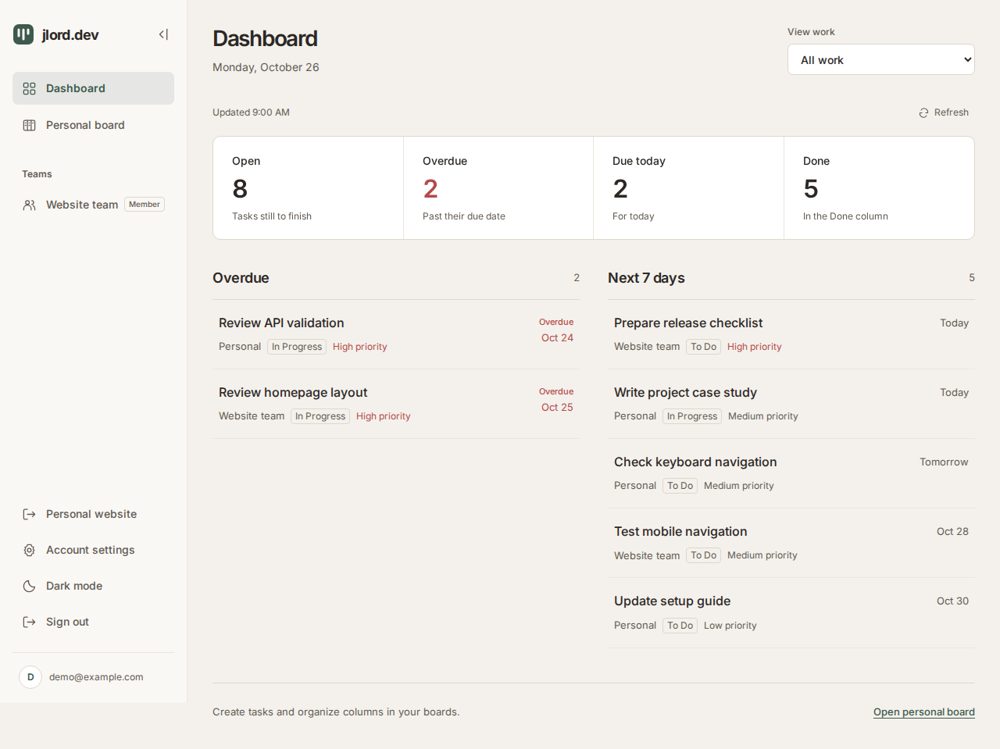

# Personal Kanban Desk

### A clear, focused workspace for turning daily work into visible progress.

Personal Kanban Desk is a full-stack task management application that helps people organise priorities, workflow stages, and deadlines in one focused workspace. This portfolio project demonstrates my ability to turn a practical product idea into a polished, maintainable web application.

[Live demo](https://kanban-desk-frontend.onrender.com/)



Dashboard capture with example tasks. A [dark-theme capture](./frontend/public/images/kanban-dashboard-dark.png) is also included.

## Personal website

The public homepage introduces Jaylord Coronado's work through a hero, a real dashboard preview, Services, and About. Four service entries cover full-stack applications, business automation, AI integration, and application maintenance, each with a supporting work example. About distinguishes professional enterprise work from Kanban Desk as an independent project and includes a shared skills inventory and an anonymous reconciliation example.

**Contact me** opens an email draft. **Explore Kanban Desk** opens `/try`; signed-in visitors continue to `/dashboard`. The homepage stays available to both guests and accounts. The website uses locally hosted Archivo and IBM Plex Sans; application screens retain their existing typography and both themes.

## The problem it solves

When work is spread across notes, messages, and disconnected lists, it becomes difficult to see what matters next. Personal Kanban Desk brings tasks, workflow stages, priorities, and dates into one readable workspace so users can plan, update, and review their work with less friction.

## What users can do

- Open the personal homepage at `/`, then choose **Explore Kanban Desk** to use a guest board at `/try`, saved in this browser. Optional accounts support email confirmation, email/password or Google sign-in, and account recovery.
- Work on a private cloud board when signed in; copy device work with a preview and keep the original guest board.
- Organise work across up to seven persistent workflow columns.
- Create, edit, move, and archive tasks without leaving the board.
- Track priority, start date, due date, and expected finish date.
- Identify overdue work at a glance.
- Move tasks between workflow stages with drag-and-drop or a movement dropdown.
- Open task details in a focused, scrollable view that keeps long descriptions readable.
- Edit task titles and descriptions with explicit save, cancel, and discard choices.
- Switch between light and dark themes.
- Request an optional AI-generated description suggestion and decide whether to use it.

Guest work stays separate from cloud work. Signing out returns to the homepage; **Explore Kanban Desk** reopens the browser's guest board. Imports never overwrite cloud tasks and later guest edits do not silently update prior copies. Gemini requires sign-in and an explicit rewrite request. Cloud changes from other devices load when the app opens or refreshes; live updates and offline synchronization are outside this version.

## Product decisions

- **Clarity over clutter:** the board keeps the most important information visible while details remain available when needed.
- **Flexible workflows:** users can create and rename columns instead of being forced into a fixed process; tasks and columns save locally for guests and to Supabase for accounts.
- **Account separation:** authenticated API requests use the user's identity, with workspace access enforced in PostgreSQL.
- **Recoverable removal:** archive actions retain task records; restore is currently available through the backend API.
- **Safe editing:** unsaved changes are protected by clear confirmation flows.
- **Human review for AI:** AI suggestions remain drafts until the user applies and saves them.
- **Practical responsiveness:** the interface is designed to remain usable across different screen sizes.

## Project scope

This project demonstrates the delivery of a complete product slice: a responsive interface, task and workflow management, Supabase authentication, PostgreSQL-backed task persistence, validation, and an optional AI-assisted workflow. It is intentionally focused on a reliable core experience rather than a collection of disconnected features.

## Technical approach

The application uses a React frontend and an Express backend with Supabase Auth and PostgreSQL persistence. The codebase is written in TypeScript and separated into focused components and services so that features can be maintained and extended cleanly.

```text
project/
├── frontend/   React 19, TypeScript, Vite, Tailwind CSS v4
└── backend/    Node.js, Express, TypeScript, Supabase
```

AI requests are handled by the backend, keeping credentials away from the browser. Backend input is validated before persistence, and AI output stays a draft until the user applies and saves it. The API verifies Supabase access tokens and performs database operations under the signed-in identity. Row-level security and checked database functions enforce workspace permissions; task mutations and their activity records commit together. The API client handles failed requests and cancels stale work when accounts change.

## Technology

| Area | Technologies |
| --- | --- |
| Interface | React 19, TypeScript, Vite, Tailwind CSS v4 |
| API | Node.js, Express 5, TypeScript, Zod |
| Accounts and data | Supabase Auth, PostgreSQL, row-level security |
| Invitation email | Nodemailer with SMTP (backend capability) |
| Verification | Vitest, Testing Library, Node test runner, PGlite |
| Optional AI | Google Gemini through the Google Gen AI SDK |

## For technical reviewers

The repository includes separate setup documentation for developers who want to inspect or run the application:

- [`frontend/README.md`](./frontend/README.md) — frontend setup, commands, and environment guidance.
- [`frontend/`](./frontend/) — board interface, task editing, interactions, and themes.
- [`backend/README.md`](./backend/README.md) — database setup, API permissions, integrations, and verification boundaries.
- [`backend/`](./backend/) — authenticated API, database policies/functions, and integration tests.

## Current status

The source includes the personal homepage with Services, About, contact links, and a dashboard preview, guest boards, optional cloud accounts, revision conflict review, task archiving, account recovery, and automated tests. Signed-in users have a dashboard with task counts, overdue work, upcoming deadlines, workspace filters, and a collapsible sidebar. Personal boards remain private; existing team boards are available to their members. Account settings includes identity, appearance, and password recovery. The backend also implements team creation, role management, email invitations, archive restoration, and activity history; frontend screens for those management features remain planned, including invitation acceptance. A dedicated Projects section, full contact/footer section, and separate Kanban Desk product introduction remain planned.

Tasks, columns, renames, and archive actions persist across refreshes. Cloud writes use server-checked revisions and transactional task/column updates; outdated changes require review before applying. Failed saves retain work with an explicit retry. Clearing browser data removes guest work. The old SQLite database is not copied into Supabase automatically.

The Render link above points to the existing demo. Deployment of the latest website, account, and database changes has not been verified. The checked-in Render configuration needs additional Supabase and origin settings before it can run this version. Remaining delivery work includes live authentication/email smoke tests, dependency review, and screenshots of additional application screens. The dashboard captures use example data and do not establish live account access.

## Verification

Frontend tests cover dashboard filters and calendar dates, workspace state sharing, navigation and account settings, guest persistence, local storage failure, cloud save retry and conflicts, editor draft recovery, account forms, session transitions, API failures, recovery, and stale responses after account changes. Backend tests cover request validation, invitation mail, workspace permissions, archiving, activity transactions, board migrations, revisions, and duplicate-free guest imports. Database tests run against an isolated PostgreSQL engine; live Supabase, Google, SMTP, and browser behavior require separate checks. See the component READMEs for commands and limitations.

The website changes passed 146 frontend tests, lint, and a production build. Sixteen isolated Chromium scenarios covered both themes, narrow and landscape layouts, 200% text, section links and keyboard focus, preview enlargement, contact destinations, and text contrast. Live provider and hosted behavior require separate verification. The production build retains a bundle-size advisory.

## Why this matters to clients and teams

This project demonstrates how I approach independent software work:

- Translate a real workflow problem into a focused product experience.
- Build both the user interface and the supporting backend services.
- Make thoughtful decisions around usability, validation, persistence, and security.
- Deliver features with clear boundaries so the application can grow without becoming difficult to maintain.

## About the developer

I’m Jaylord Coronado, a full-stack developer who builds practical web applications with clear user experiences, maintainable architecture, and attention to product details.

[View my GitHub profile](https://github.com/Jlordcoronado)
